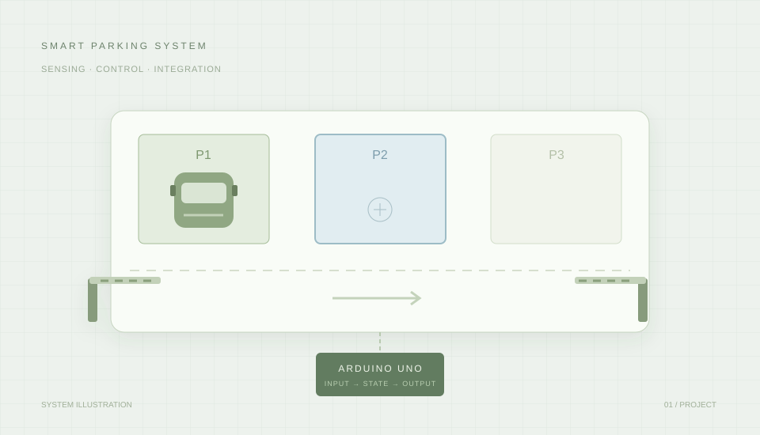

# 김정권의 포트폴리오

로봇 제어·임베디드 소프트웨어 개발 경험과 학습 기록을 정리한 웹 포트폴리오입니다.

**[포트폴리오 보기](https://obloodobladeo-spec.github.io/portfolio/)** · [이력서](https://obloodobladeo-spec.github.io/portfolio/resume/) · [프로젝트](https://obloodobladeo-spec.github.io/portfolio/projects/) · [티스토리](https://kjeongk.tistory.com/)



## 소개

조선대학교 생명화학공학과를 졸업하고, 미래융합교육원의 AI 자율주행 로봇 개발자 과정에서 로봇 소프트웨어를 배우고 있습니다. 센서 입력부터 장치 동작까지의 흐름을 이해하고, 구현과 검증 과정을 기록합니다.

### 스마트 주차장

3개 주차면을 가진 모형에서 차량 접근 감지, 주차면 안내, 정상 주차와 오주차 판정, 입·출구 차단기 제어를 연결한 팀 프로젝트입니다.

- **개인 담당:** Arduino 제어, 센서·배선, 통합 테스트
- **프로젝트 적용:** Arduino UNO, C/C++, 초음파 센서, LED, Servo
- **시스템 연동:** ESP-01, Wi-Fi/TCP, PC C++ 테스트 서버
- **기록:** [주제 선정](https://kjeongk.tistory.com/15), [제어와 테스트](https://kjeongk.tistory.com/16), [서버 연동](https://kjeongk.tistory.com/17)

상세 페이지는 시스템 구성, 직접 담당한 역할, 동작 흐름, 문제 해결 과정과 개선 과제를 구분합니다. 화면의 시각화는 구조를 설명하기 위한 그림이며 실제 장치의 실시간 실행 결과가 아닙니다.

## 사이트 구성

```text
index.html                  # 포트폴리오 메인
projects/
  index.html                # 프로젝트 목록
  smart-parking.html        # 스마트 주차장 상세
resume/
  index.html                # 이력서 · 인쇄/PDF 저장
about/
  index.html                # 자기소개서
assets/
  site.css                  # 공통 스타일 · 모바일 · 인쇄
  site.js                   # 메뉴와 프로젝트 동작 설명
  *.svg                     # 직접 작성한 구성 그림과 아이콘
```

메인에는 프로젝트 소개 카드만 배치하고, 상세 기록은 `projects/` 폴더에 모았습니다. 이력서는 `resume/`에 별도로 구성했습니다.

## 로컬 확인

별도의 패키지 설치나 빌드 과정이 필요 없는 HTML/CSS/JavaScript 사이트입니다.

```sh
python -m http.server 8000
```

브라우저에서 `http://localhost:8000`을 엽니다. 이력서 페이지의 **인쇄 / PDF 저장** 버튼으로 인쇄 화면을 열 수 있습니다. PDF 저장은 브라우저의 인쇄 대상에서 선택합니다.

## 수정과 배포

- 소개·학력·기술 요약은 `index.html`에서 수정합니다.
- 프로젝트를 추가할 때는 `projects/` 안에 상세 페이지를 만들고 메인과 프로젝트 목록에 카드를 연결합니다.
- 이력서와 자기소개서는 각각 `resume/index.html`, `about/index.html`에서 수정합니다.
- GitHub Pages의 배포 소스는 `main` 브랜치의 루트(`/`)입니다.

이 저장소에는 포트폴리오 웹페이지 코드가 들어 있습니다. 스마트 주차장의 Arduino 펌웨어와 C++ 서버 소스는 포함하지 않습니다.
